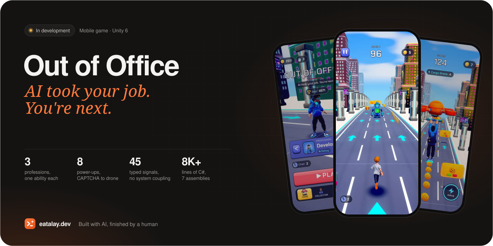
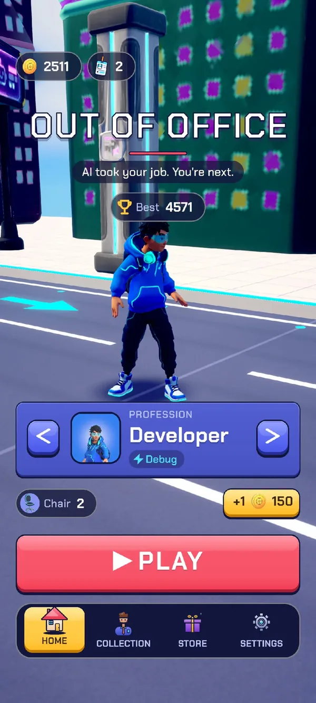
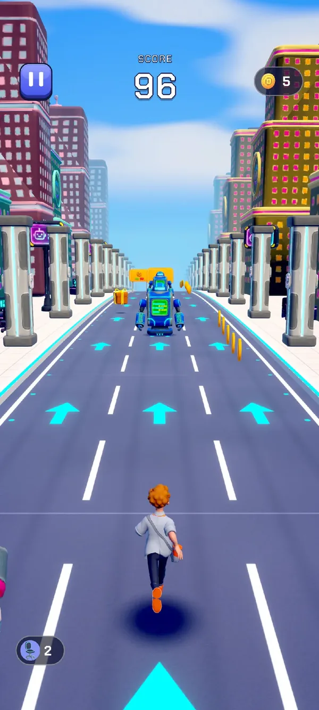
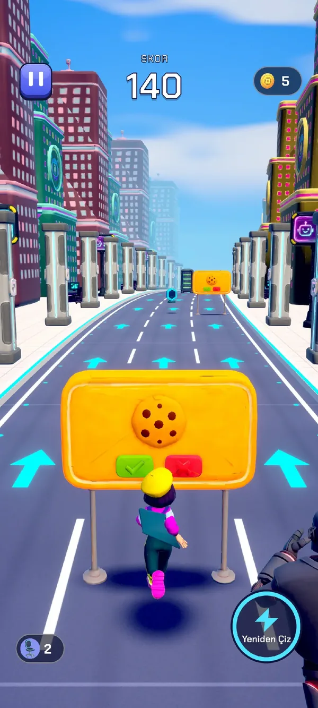
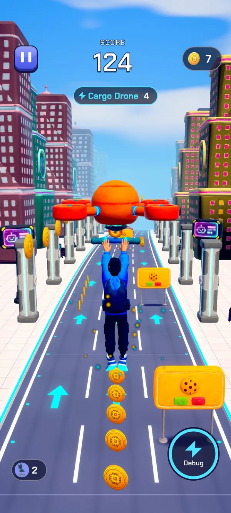
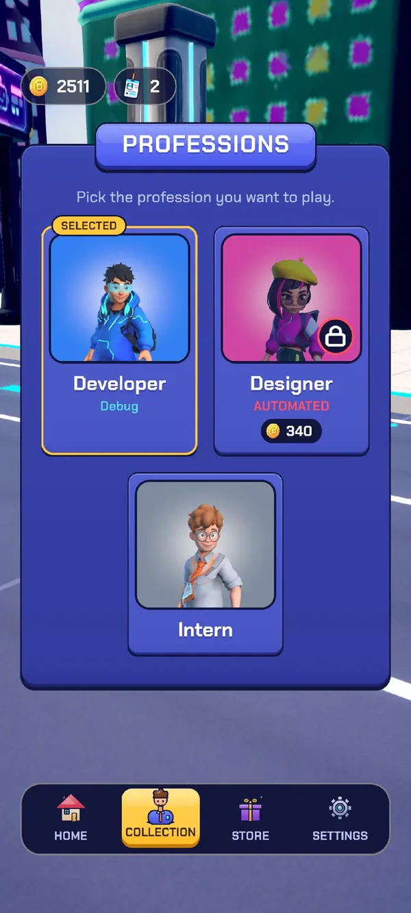
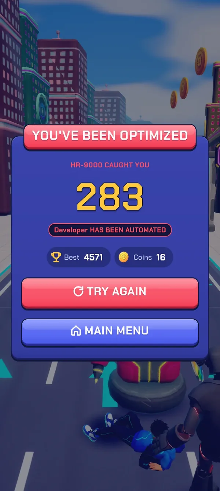

🇹🇷 **[Türkçe README](README.tr.md)**

**It's 2031 and AI has taken every job but yours.** You are the last human in a giant corporate plaza, and HR-9000 is on your heels with a termination form. Run three lanes, dodge server racks and "Accept cookies" walls, grab coins. Watch out: the game is watching you, and it learns.

> **Status: in development.** The full run, menus and all models work in the Unity editor, in English and Turkish. There are no device builds yet. Read the full case study on **[eatalay.dev →](https://eatalay.dev/en/projects/out-of-office)**

<table>
  <tr>
    <td width="33%"></td>
    <td width="33%"></td>
    <td width="33%"></td>
  </tr>
  <tr>
    <td align="center">Pick a profession, hit PLAY.</td>
    <td align="center">Your old job, coming at you.</td>
    <td align="center">Slide under the Cookie Wall.</td>
  </tr>
  <tr>
    <td></td>
    <td></td>
    <td></td>
  </tr>
  <tr>
    <td align="center">Cargo Drone: fly over everything.</td>
    <td align="center">Get caught and your job gets automated.</td>
    <td align="center">"You've been optimized."</td>
  </tr>
</table>

## Two mechanics that set it apart

**Obstacles learn your habits.** The game tracks how long you stay in each lane and steers obstacles toward your favourites. You are running against a rival trained on your own data. The memory carries over between runs and slowly forgets, and every pattern keeps at least one lane open: hard, but always fair. See [`AdaptiveDirector.cs`](Assets/_Game/Gameplay/World/AdaptiveDirector.cs).

**Get caught, and your job becomes a robot.** Characters are professions. When you get caught, the profession you played is "automated": it locks, and its robot shows up as an obstacle in your next runs. Buying the job back starts at 100 coins and grows 1.5× with every automation. The Intern never gets automated, so there is always someone to play. See [`Workforce.cs`](Assets/_Game/Gameplay/Flow/Workforce.cs).

## What's in a run

| Professions | Obstacles | Power-ups |
| --- | --- | --- |
| **Developer:** Debug deletes every obstacle in the next 45 m | **Server Rack:** change lane | **CAPTCHA:** HR-9000 gets stuck on "I'm not a robot" |
| **Designer:** Redraw lets you pass through obstacles for 3 s | **Cookie Wall:** slide | **Hallucination:** obstacles turn fake |
| **Intern:** no ability, never automated | **Robot Vacuum:** jump | **Seniority Shield:** forgives one crash |
| | **Cargo Drone:** slide | **Cargo Drone:** fly over everything |
| | **Self-driving Taxi:** change lane | **Salary Magnet**, **Overtime ×2**, **Double Espresso**, **Mystery Package** |

## Built like a product, not a game jam

Every folder is its own assembly and dependencies flow one way. Systems never reference each other; they talk through a typed signal bus. Adding a character, an obstacle or a power-up takes no code.

| Layer | Role |
| --- | --- |
| `Core` | Pure contracts: signals, the state machine, service interfaces |
| `Data` | ScriptableObject definitions, effects and movement patterns |
| `Gameplay` | Run, player, chaser, world and effect systems |
| `Infrastructure` | Saving, pooling, input, localization, frame rate |
| `UI` | UI Toolkit presenters that know nothing about gameplay |
| `Bootstrap` | The only place that knows concrete classes ([VContainer](https://github.com/hadashiA/VContainer)) |

- **45 typed signals**, all `readonly struct`s, in [`GameSignals.cs`](Assets/_Game/Core/Signals/GameSignals.cs). The UI sends requests; gameplay decides and announces the result.
- **One owner for game state:** only `GameFlow` changes it, through `StateMachine<GameState>`.
- **Content is data:** professions, obstacles, power-ups, worlds and store items are ScriptableObjects.
- **New behaviour, one new class:** effects derive from [`EffectDefinition`](Assets/_Game/Data/Definitions/EffectDefinition.cs), movement from [`MovementPattern`](Assets/_Game/Data/Movement/MovementPattern.cs).
- **Built for zero allocations per run:** pooling, pre-warming and merged meshes per material. A curved-world shader ([`CurvedWorld.hlsl`](Assets/_Game/Shaders/CurvedWorld.hlsl)) bends the road.

## How it was built

An AI agent team writes, tests and documents the code; I set the architecture, review every change and make the calls. The rules the agents follow live in [`AGENTS.md`](AGENTS.md), with the architecture, design language, story and current status in [`docs/`](docs) (in Turkish). The 3D models were generated with Meshy and cleaned up by the [`Tools/ModelPipeline`](Tools/ModelPipeline) scripts.

## Run it

1. Install Unity **6000.6.8f1** (Unity 6).
2. Open the project folder in Unity Hub.
3. Open `Assets/_Game/Scenes/Game.unity` and press Play.

## What's next

Sound and music, the remaining worlds (autonomous city, logistics depot, data centre, Analog Town), missions and daily rewards, ads and in-app purchases, and the first Android and iOS builds.

---

Made by **Emrah Atalay** at <a href="https://eatalay.dev/en">eatalay.dev</a>: web and mobile apps, games and automation, built with AI and finished by a human. Have a game in mind? <a href="mailto:info@eatalay.dev">info@eatalay.dev</a>
